## 🌿 Sobre mí

¡Hola! Soy **Charis Conrado**, estudiante de **Ingeniería en Sistemas** desde Bogotá, Colombia 🇨🇴.

He aprendido desarrollo de software y ahora estoy cruzando la puerta hacia el mundo de la **ciberseguridad**. Este rincón irá creciendo con mis laboratorios, retos y proyectos a medida que avance.

- 🏡 Base: desarrollo de software
- 🔭 Explorando ahora: ciberseguridad, redes, Linux y pentesting
- 🌱 Próximamente aquí: laboratorios, writeups y proyectos

## 🗺️ Mi mapa de viaje

| Rama | Qué me atrae |
|---|---|
| 🛡️ **Blue Team / SOC** | Detectar, analizar y responder a incidentes |
| ⚔️ **Red Team / Pentesting** | Pensar como atacante para encontrar fallas antes que otros |
| 🔮 **Purple Team** | Unir ataque y defensa para mejorar ambos |
| 🔍 **Informática forense** | Seguir las huellas digitales en laboratorios prácticos |

## 🧰 Mi caja de herramientas

## 🎯 Mis metas

- [ ] Completar mis primeros laboratorios prácticos
- [ ] Publicar mis primeros writeups y proyectos
- [ ] Conseguir mi primera certificación en ciberseguridad
- [ ] Trabajar en un SOC o como pentester
- [ ] Montar mi propio laboratorio de informática forense

<!--
Cuando ya tengas actividad en GitHub, quita estas marcas de comentario
y cambia ChamecoSec si tu usuario es otro:

## 📊 Mi bosque en números

  
  

-->

<!--
## 📫 Contacto (agrégalo cuando tengas tus cuentas)
- [LinkedIn](https://linkedin.com/in/tu-usuario)
- [TryHackMe](https://tryhackme.com/p/tu-usuario)
- [HackTheBox](https://app.hackthebox.com/users/tu-id)
-->

